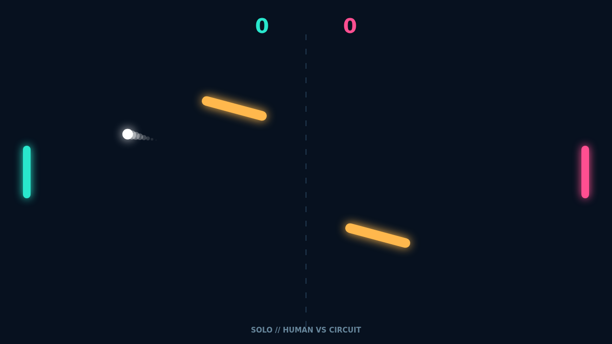

# Carom

Carom turns a familiar paddle duel into a game of angles. Every rally starts clean and fast, then opens into a scramble as the ball meets two bright bars swaying and rotating through midfield.

Move through contact and the paddle puts spin on the ball. A straight return can curl late, skim a wall, or bend just far enough to leave an opponent reaching. The luminous trail makes every change in direction readable.

The obstacles make ambitious shots feel wonderful. Catch a tilted face at the right moment and the ball caroms into a route neither player expected; misjudge it, and your bank shot comes straight back at you.

Play Solo against the reactive circuit or share the keyboard in Versus. Matches run to 11 and demand a two-point lead, so a close match keeps tightening all the way through match point.

